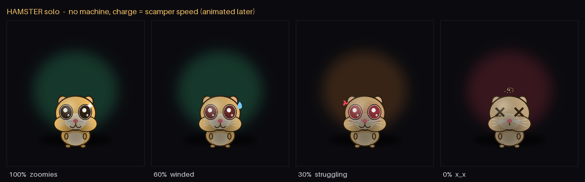

# inframagotchi

Un tamagotchi pour votre homelab : un petit chat manga qui vit dans une fenêtre et dépérit à mesure que votre infrastructure se dégrade.

[](LICENSE)
[](https://github.com/bengua/inframagotchi/actions/workflows/ci.yml)

**Tutoriel** : [installation pas à pas sur freedzhost.cloud](https://freedzhost.cloud/fr/inframagotchi.html) · [step-by-step tutorial on freedzhost.cloud (EN)](https://freedzhost.cloud/en/inframagotchi.html)



## Présentation

Infra en bonne santé : yeux brillants, ronronnement tranquille. Dès que des
choses commencent à lâcher : goutte de sueur, veine de stress, cernes,
pansement, et pour finir les yeux en croix quand il s'effondre.

L'animal ne connaît qu'une seule chose : *la santé actuelle, de 0 à 100*. Les
sondes (`probes/`) la calculent à partir du vrai système (services systemd,
certificats, sauvegardes, disque, réseau...) et le moteur HTTP local la pousse
vers la fenêtre. C'est tout l'intérêt d'une application native plutôt qu'un
onglet de navigateur : un navigateur est isolé et ne peut pas lire `systemctl`,
des certificats ou l'occupation disque. Un moteur local, si.

## Fonctionnalités

- **Sondes** : `disk`, `service` (systemd), `cert`, `backup`, `ping`, `http`,
  `ssh`, `load`, `ram`. La santé globale est celle du maillon le plus faible.
- **Tolérance aux pannes** : une sonde dont l'outil est absent (hors Linux par
  exemple) reste neutre au lieu de faire planter l'application.
- **Trois modes** : bureau (tout sur une machine), serveur (moteur seul), client
  (fenêtre seule pointée vers un moteur distant).
- **Mode compagnon** : une petite fenêtre sans bordure, toujours au premier plan.
- **Avatars** : chat (par défaut), chien, poisson, hamster, lama, hors-ligne.
  Voir [docs/avatars.md](docs/avatars.md).
- **Éditeur intégré** : modification de la configuration depuis l'application,
  validée et rechargée à chaud.
- **Mode démo** : un curseur pour parcourir toute la déchéance de 100 % à 0 %.

## Installation depuis zéro

### Prérequis

- Linux, Python 3.11 ou plus récent, [uv](https://docs.astral.sh/uv/) et git.
- Un moteur de rendu pour pywebview : soit GTK/WebKit du système, soit Qt
  (installé via l'extra `qt`, sans paquet système à ajouter).

Avec GTK/WebKit (exemple Arch ; adaptez les noms pour Debian ou Fedora) :

```sh
sudo pacman -S --needed webkit2gtk-4.1 python-gobject python-cairo
```

### Installation

```sh
git clone https://github.com/bengua/inframagotchi
cd inframagotchi

# variante GTK/WebKit : le virtualenv doit voir les bindings du système
uv venv --system-site-packages
uv sync

# ou variante Qt
uv sync --extra qt
```

### Premier lancement

```sh
uv run python app.py
```

La fenêtre s'ouvre avec une sonde disque par défaut. Ajoutez ensuite vos propres
sondes (voir Configuration). Le guide détaillé, avec les services systemd et le
déploiement serveur + client, est dans [docs/install.md](docs/install.md).

## Utilisation

```sh
# bureau : moteur local + fenêtre locale (par défaut)
uv run python app.py

# serveur : moteur seul, sans fenêtre
uv run python app.py --serve

# client : fenêtre seule, pointée vers un moteur distant
uv run python app.py --connect http://engine.local:8080

# compagnon : fenêtre carrée sans bordure, toujours au premier plan
uv run python app.py --pet --pet-size 180
```

Le moteur expose aussi une petite API :

| Chemin | Méthode | Rôle |
|---|---|---|
| `/` | GET | Interface web |
| `/health` | GET | Santé globale (`{ "health": 0–1 }`) |
| `/status` | GET | Détail par sonde |
| `/config` | GET | Configuration active |
| `/config` | POST | Valider, enregistrer et recharger la configuration |

**Sécurité** : `POST /config` permet à quiconque atteint le moteur de réécrire
la configuration. Par défaut le moteur n'écoute que sur `127.0.0.1`. Si vous
l'exposez (`0.0.0.0`), protégez-le par un pare-feu ou un VPN : il n'y a pas
d'authentification.

## Configuration

Les sondes sont déclarées dans `inframagotchi.json`, cherché dans cet ordre :

1. `$INFRAMAGOTCHI_CONFIG`
2. `./inframagotchi.json`
3. `$XDG_CONFIG_HOME/inframagotchi/inframagotchi.json`
4. `~/.config/inframagotchi/inframagotchi.json`

Une configuration absente ou invalide retombe sur une seule sonde disque.

```json
{
  "avatar": "avatars/hamster.html",
  "probe": [
    { "type": "disk", "path": "/", "warn": 0.8, "critical": 0.95 },
    { "type": "service", "unit": "sshd.service" },
    { "type": "cert", "path": "/etc/letsencrypt/live/example.com/fullchain.pem", "warn_days": 30, "critical_days": 7 },
    { "type": "backup", "pattern": "/backups/*.gpg", "max_age_hours": 24 },
    { "type": "ping", "host": "1.1.1.1", "count": 1, "timeout": 5 },
    { "type": "http", "url": "https://example.com", "warn_ms": 500, "critical_ms": 2000, "timeout": 5 },
    { "type": "ssh", "host": "nas.lan", "user": "backup", "command": "uptime", "expected": "load average" },
    { "type": "load", "warn": 2.0, "critical": 4.0 },
    { "type": "ram", "warn": 0.75, "critical": 0.9 }
  ]
}
```

Chaque sonde accepte un `interval` en secondes (5 par défaut). Changer
d'avatar demande un redémarrage.

Variables d'environnement :

| Variable | Rôle |
|---|---|
| `INFRAMAGOTCHI_CONFIG` | Chemin explicite du fichier de configuration |
| `XDG_CONFIG_HOME` | Racine de la configuration utilisateur |
| `INFRAMAGOTCHI_RUNS_DIR` | Optionnel : dossier d'un exécuteur de tâches, exposé via `/runs` |
| `INFRAMAGOTCHI_RUN_EVENTS_DIR` | Optionnel : journaux d'événements par tâche, exposés via `/runs/<id>` |

Les deux dernières sont désactivées par défaut ; sans elles `/runs` renvoie une
liste vide.

## Pourquoi ce projet

Un tableau de bord, on finit par ne plus le regarder ; un petit animal qui tire
la langue dans un coin de l'écran, si. inframagotchi transforme la supervision
en compagnon, pour apprendre en jouant comment se porte vraiment son serveur.
Tout tourne en local, sur votre machine, sans cloud ni compte : votre infra
reste chez vous.

## Licence

[MIT](LICENSE).

## English

A tamagotchi for your homelab: a small manga cat living in a window that
degrades as your infrastructure does. Local probes (systemd services,
certificates, backups, disk, network...) compute a 0-100 health score, and a
local HTTP engine pushes it to the window.

**Install**

```sh
git clone https://github.com/bengua/inframagotchi
cd inframagotchi
uv venv --system-site-packages && uv sync   # system GTK/WebKit
# or: uv sync --extra qt                    # Qt backend
uv run python app.py
```

See [docs/install.md](docs/install.md) for system packages, systemd services and
the server + client setup.

**Usage**: `app.py` (desktop), `app.py --serve` (engine only),
`app.py --connect URL` (window only), `app.py --pet` (frameless companion).
Probes live in `inframagotchi.json` (or `$INFRAMAGOTCHI_CONFIG`).

**Why**: dashboards get ignored; a small sulking pet in the corner of your
screen does not. Monitoring turned into a companion, fully local, no cloud, no
account.

**License**: [MIT](LICENSE).

---

Un projet [FreedzHost](https://freedzhost.cloud) — souveraineté numérique, IA locale, homelab.
A [FreedzHost](https://freedzhost.cloud) project.
